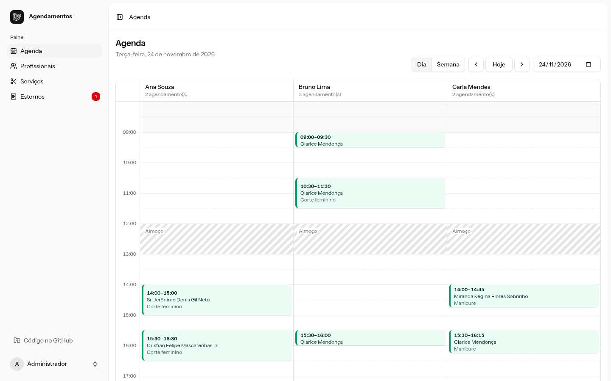
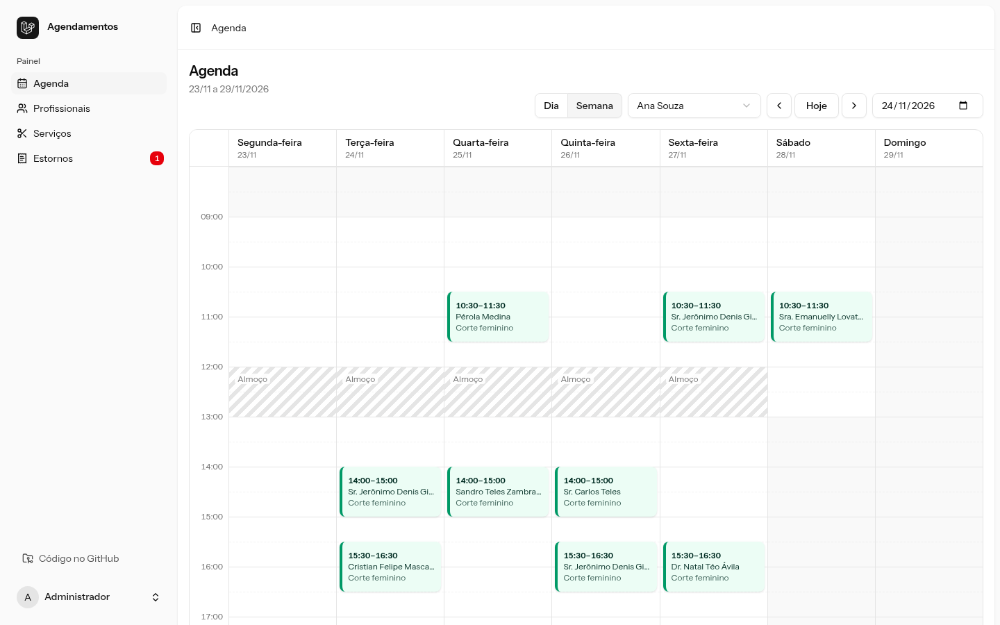
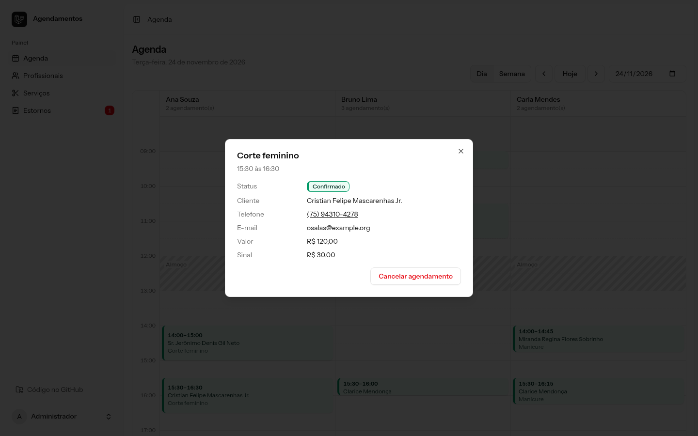
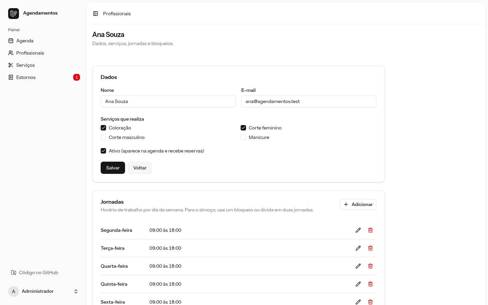
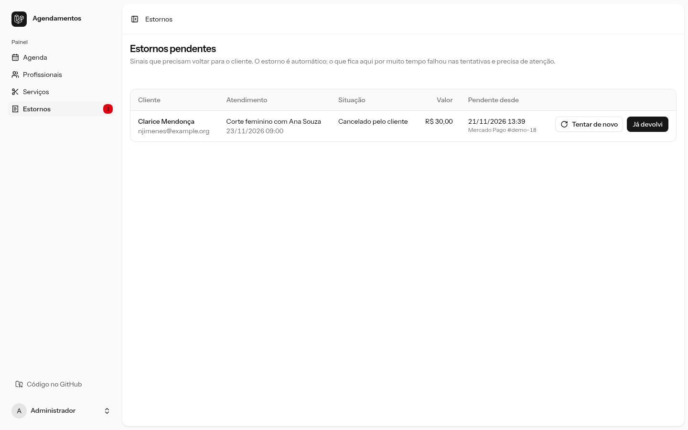
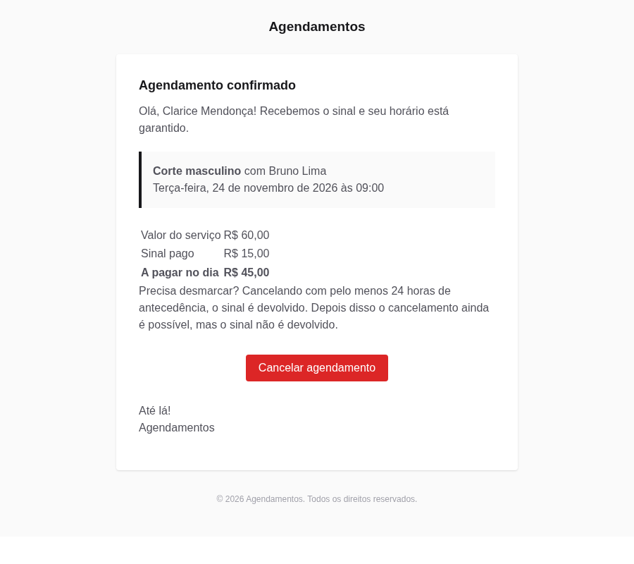
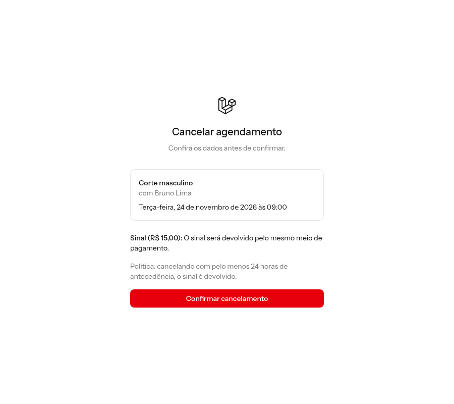
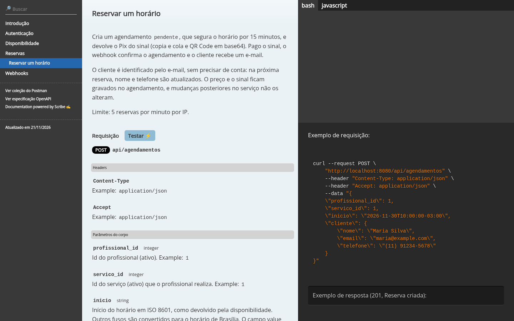

# Agendamentos

[](https://github.com/rafaelamiranda/agendamentos-laravel/actions/workflows/ci.yml)

Sistema de agendamentos para estabelecimentos de serviço (salão, clínica, estúdio), feito em Laravel 13 como projeto de portfólio. O cliente consulta os horários livres de um profissional, reserva pela API e paga um **sinal via Pix** (Mercado Pago); a confirmação chega por webhook, e os e-mails de confirmação, lembrete e cancelamento saem pela fila. O estabelecimento gerencia tudo num painel em React.

O foco está nas partes que costumam dar problema em sistemas de agenda: **duas pessoas reservando o mesmo horário ao mesmo tempo**, **webhooks repetidos ou fora de ordem**, **dinheiro sem erro de arredondamento** e **efeitos colaterais (e-mail, estorno) que só acontecem se a transação for gravada**. Cada decisão está explicada em [Decisões técnicas](#decisões-técnicas).



## Funcionalidades

- **Disponibilidade**: horários livres por profissional, serviço e data, considerando jornada, bloqueios (folgas, férias, almoço), agendamentos e antecedência mínima e máxima.
- **Reserva com lock**: o agendamento nasce `pendente`, segurando o horário por 15 minutos; o `SELECT ... FOR UPDATE` na linha do profissional impede reserva dupla, comprovado por teste com dois processos.
- **Sinal via Pix**: cobrança no Mercado Pago gerada depois do commit, com chave de idempotência; se o gateway falhar, a reserva é desfeita.
- **Webhook idempotente**: assinatura HMAC, resposta imediata, processamento em fila consultando a API do Mercado Pago, com transições de status que não regridem.
- **Expiração e lembretes agendados**: reservas não pagas vencem sozinhas; lembrete por e-mail 24 h antes, nunca em dobro.
- **Cancelamento**: o cliente cancela por link assinado no e-mail, e o estabelecimento pelo painel; o sinal é devolvido automaticamente conforme a política de prazo.
- **Painel administrativo** (Inertia + React + TypeScript): agenda visual do dia e da semana, cadastro de profissionais, serviços, jornadas e bloqueios, e acompanhamento de estornos, com Policies.
- **Documentação da API** gerada com Scribe (HTML, OpenAPI e Postman).
- **Tudo em português**: código, banco, testes, mensagens, e-mails e telas.

## Telas

| Agenda da semana                                           | Detalhe e cancelamento                                         |
| ---------------------------------------------------------- | -------------------------------------------------------------- |
|           |        |
| **Profissional: serviços, jornadas e bloqueios**           | **Estornos pendentes**                                         |
|    |                  |
| **E-mail de confirmação**                                  | **Cancelamento pelo cliente (link do e-mail)**                 |
|  |  |



## Fluxo de uma reserva

```mermaid
sequenceDiagram
    autonumber
    actor C as Cliente
    participant API as API Laravel
    participant DB as MySQL
    participant MP as Mercado Pago
    participant F as Fila (Redis)

    C->>API: GET /api/profissionais/{id}/disponibilidade
    API-->>C: horários livres
    C->>API: POST /api/agendamentos
    API->>DB: BEGIN; SELECT profissional FOR UPDATE
    API->>DB: confere o horário de novo e cria o agendamento pendente
    API->>DB: COMMIT
    API->>MP: cria o Pix (X-Idempotency-Key)
    API-->>C: 201 com o Pix copia e cola
    C->>MP: paga o sinal
    MP->>API: POST /api/webhooks/mercadopago (assinado)
    API->>F: enfileira o processamento
    API-->>MP: 200
    F->>MP: GET /v1/payments/{id} (fonte da verdade)
    F->>DB: lock no pagamento e no agendamento: confirmado
    F-->>C: e-mail de confirmação com o link de cancelamento
```

## Stack

- Laravel 13, PHP 8.5 (Sail), MySQL 8.4, Redis (filas)
- Painel: starter kit oficial React (Inertia + React + TypeScript, Tailwind, shadcn/ui)
- Pagamento: Mercado Pago (Pix) em sandbox, pela API HTTP, sem SDK
- E-mails: Mailables em Markdown, em fila; Mailpit em desenvolvimento
- Documentação da API: Scribe
- Testes com Pest; qualidade com Laravel Pint e Larastan (nível 5)
- CI no GitHub Actions: um job para Pint + PHPStan e outro para o Pest em MySQL

## Como rodar

Requisitos: Docker. O PHP não precisa estar instalado na máquina.

```bash
cp .env.example .env

# Instala as dependências PHP usando um container descartável
docker run --rm -u "$(id -u):$(id -g)" -v "$(pwd)":/var/www/html -w /var/www/html \
    laravelsail/php84-composer:latest composer install

./vendor/bin/sail up -d
./vendor/bin/sail artisan key:generate
./vendor/bin/sail artisan migrate --seed
./vendor/bin/sail npm install
./vendor/bin/sail npm run build
```

| Serviço   | Endereço              |
| --------- | --------------------- |
| Aplicação | http://localhost:8080 |
| Mailpit   | http://localhost:8025 |

A aplicação usa `APP_PORT=8080` para não disputar a porta 80 com outros containers.

Usuário administrador do seeder: `admin@agendamentos.test`, senha `password`.

**SELinux (Fedora/RHEL):** se os containers não conseguirem ler ou gravar nos volumes, adicione `:z` aos volumes de bind no `compose.yaml` (por exemplo `'.:/var/www/html:z'`).

### Fila, agendador e Mercado Pago

Os avisos de pagamento são processados na fila (Redis), e as reservas vencidas são expiradas pelo agendador. Em desenvolvimento, rode cada um num terminal:

```bash
./vendor/bin/sail artisan queue:work
./vendor/bin/sail artisan schedule:work
```

Para gerar Pix de verdade no sandbox, crie uma aplicação no [painel de desenvolvedores do Mercado Pago](https://www.mercadopago.com.br/developers/panel/app) e preencha no `.env`:

| Variável                       | Onde encontrar                                                                                      |
| ------------------------------ | --------------------------------------------------------------------------------------------------- |
| `MERCADOPAGO_ACCESS_TOKEN`     | Credenciais de teste (começa com `TEST-`)                                                           |
| `MERCADOPAGO_WEBHOOK_SECRET`   | Webhooks > Configurar notificações > assinatura secreta                                             |
| `MERCADOPAGO_NOTIFICATION_URL` | URL pública que aponta para `/api/webhooks/mercadopago` (em desenvolvimento, um túnel como o ngrok) |

Os testes não dependem disso: todas as chamadas ao Mercado Pago são simuladas com `Http::fake`, e qualquer chamada não simulada faz o teste falhar.

## Painel

Em http://localhost:8080, entre com o administrador do seeder (`admin@agendamentos.test` / `password`). O seeder cria uma semana de agenda de demonstração: atendimentos concluídos no passado, confirmados e aguardando sinal no futuro, e almoço bloqueado nos dias úteis.

| Tela          | O que faz                                                                                                                                                                                                                             |
| ------------- | ------------------------------------------------------------------------------------------------------------------------------------------------------------------------------------------------------------------------------------- |
| Agenda        | Grade visual por **dia** (uma coluna por profissional) ou por **semana** (um profissional, segunda a domingo), com expediente, bloqueios e agendamentos por status; clique num atendimento para ver cliente, valores e prazo do sinal |
| Profissionais | Cadastro, serviços que cada um realiza, jornadas por dia da semana e bloqueios (folgas, férias, almoço)                                                                                                                               |
| Serviços      | Cadastro com duração, preço e sinal digitados em reais                                                                                                                                                                                |
| Estornos      | Sinais que precisam voltar para o cliente e cujo estorno automático ainda não foi confirmado; permite tentar de novo ou registrar a devolução manual                                                                                  |

O painel é só para administradores (coluna `users.administrador`); o cadastro público do starter kit está desligado.

## E-mails e cancelamento

Os e-mails saem pela fila e, em desenvolvimento, aparecem no Mailpit (http://localhost:8025):

| E-mail                 | Quando                                                                                           |
| ---------------------- | ------------------------------------------------------------------------------------------------ |
| Agendamento confirmado | O pagamento do sinal é aprovado; traz valores, o que falta pagar no dia e o link de cancelamento |
| Lembrete               | Até 24 h antes do horário (job a cada 15 min); não sai para quem reservou já dentro dessas 24 h  |
| Agendamento cancelado  | Cancelamento pelo cliente ou pelo estabelecimento; diz o que acontece com o sinal                |

**Política de cancelamento** (`AGENDAMENTO_PRAZO_CANCELAMENTO_HORAS`, padrão 24):

| Quem cancela                 | Quando                              | Sinal                                               |
| ---------------------------- | ----------------------------------- | --------------------------------------------------- |
| Cliente, pelo link do e-mail | Até 24 h antes                      | Devolvido automaticamente (estorno no Mercado Pago) |
| Cliente, pelo link do e-mail | Com menos de 24 h                   | Retido; o horário é liberado                        |
| Estabelecimento, pelo painel | A qualquer momento antes do horário | Sempre devolvido                                    |

## API

| Método | Rota                                                                  | O que faz                                                                                        |
| ------ | --------------------------------------------------------------------- | ------------------------------------------------------------------------------------------------ |
| `GET`  | `/api/profissionais/{id}/disponibilidade?servico_id=&data=AAAA-MM-DD` | Horários livres do profissional para o serviço no dia                                            |
| `POST` | `/api/agendamentos`                                                   | Reserva um horário: cria o agendamento `pendente` e devolve o Pix do sinal (5 por minuto por IP) |
| `POST` | `/api/webhooks/mercadopago`                                           | Recebe os avisos de pagamento (assinatura HMAC obrigatória)                                      |

Exemplo de reserva:

```json
POST /api/agendamentos
{
  "profissional_id": 1,
  "servico_id": 1,
  "inicio": "2026-11-30T10:00:00-03:00",
  "cliente": { "nome": "Maria Silva", "email": "maria@example.com", "telefone": "(11) 91234-5678" }
}
```

| Resposta | Quando                                                                                                        |
| -------- | ------------------------------------------------------------------------------------------------------------- |
| `201`    | Reserva criada, com `expira_em` = agora + prazo do sinal e `pagamento.pix` (copia e cola e QR Code em base64) |
| `409`    | Horário indisponível: ocupado, fora da grade ou da jornada, fora da antecedência mínima ou máxima             |
| `422`    | Dados inválidos, ou o profissional não realiza o serviço                                                      |
| `429`    | Limite de reservas por IP atingido                                                                            |
| `503`    | O Pix não pôde ser gerado; a reserva é desfeita e o horário volta a ficar livre                               |

A documentação completa, com parâmetros, exemplos e todos os cenários de resposta, está em [`public/docs`](public/docs/index.html) (com o projeto rodando: http://localhost:8080/docs/index.html), junto com a [especificação OpenAPI](public/docs/openapi.yaml) e a [coleção do Postman](public/docs/collection.json). Para regerar: `./vendor/bin/sail artisan scribe:generate`.

Depois do pagamento, o webhook confirma o agendamento (`pendente` → `confirmado`). Sem pagamento, a reserva vence em 15 minutos e o horário volta para a disponibilidade.

## Modelo de domínio

| Tabela                 | Conteúdo                                                                                                                             |
| ---------------------- | ------------------------------------------------------------------------------------------------------------------------------------ |
| `profissionais`        | nome, e-mail único, ativo                                                                                                            |
| `servicos`             | nome, descrição, duração, preço e sinal (centavos), ativo                                                                            |
| `profissional_servico` | quais serviços cada profissional atende (chave primária composta)                                                                    |
| `jornadas`             | faixa de trabalho por dia da semana (0 = domingo … 6 = sábado)                                                                       |
| `bloqueios`            | folgas, férias, almoço                                                                                                               |
| `clientes`             | nome, e-mail único, telefone                                                                                                         |
| `agendamentos`         | profissional, serviço, cliente, início/fim, status, valores copiados do serviço, prazo do sinal, quem cancelou, envio do lembrete    |
| `pagamentos`           | sinal de um agendamento: id no Mercado Pago, status, Pix (copia e cola e QR Code), aprovação, estorno e a pendência `requer_estorno` |

Status do agendamento (`App\Enums\StatusAgendamento`): `pendente` (aguardando sinal, expira), `confirmado`, `concluido`, `cancelado`, `expirado`. Status do pagamento (`App\Enums\StatusPagamento`): `pendente`, `aprovado`, `recusado`, `cancelado`, `estornado`, com as transições permitidas definidas no próprio enum.

## Estrutura do código

```
app/
├── Actions/            casos de uso: ReservarHorario, CancelarAgendamento,
│                       GerarCobrancaPix, AplicarStatusPagamento
├── Enums/              StatusAgendamento, StatusPagamento, SituacaoSinal, OrigemCancelamento
├── Http/
│   ├── Controllers/Api     disponibilidade, reserva e webhook
│   ├── Controllers/Painel  agenda, cadastros, cancelamento e estornos (Inertia)
│   ├── Middleware          ValidarAssinaturaMercadoPago
│   ├── Requests            Form Requests da API e do painel
│   └── Resources           AgendamentoResource, PagamentoResource
├── Jobs/               ProcessarNotificacaoPagamento, EstornarPagamento,
│                       ExpirarReservasVencidas, EnviarLembretes
├── Mail/               confirmação, lembrete e cancelamento
├── Models/             com o trait Concerns/TemIntervalo (intervalos semiabertos)
├── Pagamentos/         interface GatewayPix e MercadoPagoGateway
├── Policies/           uma por model, todas a partir de PolicyDeAdministrador
├── Services/           CalculadoraDisponibilidade, MontarAgenda
└── Support/            Dinheiro (reais ⇄ centavos sem float)
resources/js/pages/     agenda, profissionais, servicos, estornos, publico (cancelamento)
tests/
├── Unit/               enums e conversão de dinheiro
├── Feature/            API, painel, pagamentos, cancelamento, e-mails
└── Concorrencia/       dois processos disputando o mesmo horário (MySQL real)
```

## Qualidade e testes

```bash
./vendor/bin/sail pint                          # estilo
./vendor/bin/sail php vendor/bin/phpstan analyse  # análise estática (nível 5)
./vendor/bin/sail artisan test                  # Pest, no banco "testing" do MySQL do Sail
./vendor/bin/sail npm run types:check           # TypeScript do painel
./vendor/bin/sail npm run build                 # o build roda no Sail: o Wayfinder chama o php
./vendor/bin/sail artisan scribe:generate       # regenera a documentação da API
```

São 288 testes (959 asserções). Além dos cenários felizes, eles cobrem bordas de horário (encostar não é conflito, o limite exato de 24 h, o último horário da jornada), a corrida entre duas reservas com dois processos reais, webhooks repetidos, fora de ordem ou com assinatura forjada, e autorização de todas as rotas do painel. Para conferir que os testes pegam erro de verdade, as garantias principais foram quebradas de propósito (tirar o lock, ler antes do lock, liberar a policy, aceitar assinatura errada, estornar duas vezes), e em todos os casos algum teste falhou.

## Decisões técnicas

### Dados, dinheiro e tempo

**Fuso horário único (America/Sao_Paulo).** O sistema atende um estabelecimento num único fuso. Por isso o `timezone` da aplicação é fixo em `config/app.php`, e as datas são gravadas e exibidas no horário de Brasília. Assim a agenda no banco é legível e as consultas por dia não precisam de conversão. Como o Brasil não tem mais horário de verão, não existem horas duplicadas ou puladas. Atender vários fusos pediria gravar em UTC e converter na exibição; aqui seria complexidade sem uso.

**"Agora" vem do PHP, não do MySQL.** As consultas usam `now()` do Laravel em vez de `NOW()` do banco. Assim valem o fuso da aplicação e o relógio congelado dos testes (`freezeTime`/`travel`).

**Datas imutáveis.** O starter kit configura `Date::use(CarbonImmutable::class)`. Em código de agenda, `$inicio->addMinutes(30)` devolve uma data nova e não altera `$inicio` sem querer.

**Valores em centavos (inteiros).** `float` não representa valores como 0,10 com exatidão, e somas e percentuais acumulariam erro de arredondamento. Inteiros em centavos são exatos e são o formato que gateways de pagamento costumam usar.

**Preço e sinal copiados para o agendamento.** O agendamento guarda `valor_centavos` e `sinal_centavos` do momento da reserva. Se o preço do serviço mudar depois, o que o cliente contratou continua valendo.

**Intervalos semiabertos `[inicio, fim)`.** O instante final não pertence ao intervalo. Dois intervalos se sobrepõem quando `A.inicio < B.fim` e `A.fim > B.inicio` (trait `TemIntervalo`, scope `sobrepondo`). Com isso, um atendimento das 10:00 às 11:00 não conflita com outro das 11:00 às 12:00, e os horários podem ser oferecidos em sequência sem folga artificial.

**`restrictOnDelete` nos agendamentos.** Agendamento é histórico financeiro. Apagar profissional, serviço ou cliente que tenha agendamentos falha no banco; o caminho certo é desativar o cadastro (`ativo`). Jornadas, bloqueios e o vínculo com serviços são dados do próprio profissional e usam `cascadeOnDelete`.

**Índice `(profissional_id, inicio, fim)`.** Atende a consulta mais frequente do sistema: "agendamentos deste profissional que cruzam este intervalo". Ela é usada no cálculo de disponibilidade e na checagem de conflito da reserva.

**Migrations não dependem do código da aplicação.** O default `'pendente'` da coluna `status` é literal, e não `StatusAgendamento::Pendente->value`. Migrations precisam continuar rodando mesmo que o enum mude no futuro.

**Código em português, com `$table` explícito.** Domínio, tabelas e testes estão em português. Os models declaram `$table` porque a pluralização do Laravel é em inglês ("profissionals"). Pelo mesmo motivo, as foreign keys informam a tabela (`constrained('profissionais')`).

### Disponibilidade

**Disponibilidade com grade fixa.** `CalculadoraDisponibilidade` oferece horários num passo fixo (`AGENDAMENTO_INTERVALO_GRADE_MINUTOS`, padrão 30), independente da duração do serviço. Um horário entra se o atendimento inteiro cabe na jornada (terminar exatamente no fim é permitido), não cruza bloqueio nem agendamento que ocupa horário e começa depois de agora + antecedência mínima (`AGENDAMENTO_ANTECEDENCIA_MINIMA_MINUTOS`, padrão 120). A grade fixa deixa a agenda previsível. O custo é que, depois de um serviço de 45 min às 9:00, o próximo horário oferecido é 10:00, e não 9:45.

**Duas consultas por dia, cruzamento em memória.** A calculadora carrega uma vez os bloqueios e os agendamentos do dia e testa cada horário candidato em memória, com `sobrepoe()`, a mesma regra semiaberta do scope. São 4 consultas no total, não importa quantos horários ou ocupações existam; um teste garante isso. Fazer uma consulta por candidato seria o problema clássico de N+1.

**Disponibilidade é informativa; a garantia é a reserva.** Entre o cliente ver um horário livre e confirmar, outra pessoa pode reservá-lo. Por isso a calculadora não "segura" nada; a reserva confere o conflito de novo, dentro de uma transação com lock de linha.

**Pendente vencido não ocupa horário, mesmo antes do job.** O scope `ocupandoHorario()` considera confirmados, concluídos e pendentes com `expira_em` no futuro. Se o job de expiração atrasar, o horário já volta a ficar livre na disponibilidade.

**Antecedência mínima e máxima.** Um horário só pode ser reservado a partir de agora + 120 min e até hoje + 60 dias (configuráveis). O limite máximo evita reservas para meses à frente, quando preços e jornadas ainda podem mudar.

**Jornadas não cruzam a meia-noite.** Cada jornada é uma faixa dentro do dia (`inicio < fim`). Turnos noturnos seriam duas jornadas, uma em cada dia. Não é o caso de salão, clínica ou estúdio.

### Reserva e concorrência

**Lock na linha do profissional, não nos agendamentos.** A reserva roda numa transação que começa com `SELECT ... FOR UPDATE` na linha do profissional (`ReservarHorario`). Duas reservas para o mesmo profissional passam uma de cada vez: a segunda espera o commit da primeira e, ao conferir a agenda, já enxerga o agendamento novo. Travar os agendamentos em conflito não resolve. Quando o horário está livre não há linha para travar, e um `FOR UPDATE` sem resultado não impede o insert de outra transação. A linha do profissional sempre existe e funciona como mutex por profissional, sem bloquear a agenda dos outros.

**O lock é a primeira consulta da transação.** No REPEATABLE READ do MySQL, o snapshot da transação nasce na primeira leitura comum. Se alguma leitura viesse antes do lock, a reserva que esperou conferiria a agenda com uma foto antiga e não veria a reserva concorrente. O teste de concorrência prova isso: com uma leitura antes do lock, ele detecta um agendamento duplicado.

**A foreign key não substitui o lock.** O `INSERT` em `agendamentos` pede um lock compartilhado na linha do profissional por causa da foreign key, então ele também espera. Mas espera depois de a agenda já ter sido conferida com dados antigos, e por isso gera duplicata. O lock explícito faz a espera acontecer antes da conferência.

**Testes de concorrência com processo separado.** `tests/Concorrencia` segura o lock numa segunda conexão e dispara a reserva num outro processo PHP, que fica esperando. Enquanto isso, o teste ocupa o horário e faz commit, e então confere que o outro processo recusou. Essa suíte usa `DatabaseTruncation` em vez de `RefreshDatabase`, porque dados dentro de uma transação não confirmada seriam invisíveis para a outra conexão.

**A disponibilidade não fica no Form Request.** O Form Request valida o formato e o vínculo profissional–serviço. Se o horário está livre depende do estado da agenda, e só é conferido com segurança dentro da transação, com o lock.

**409 para horário indisponível, 422 para dados inválidos.** Um horário ocupado não é erro de preenchimento: o pedido é válido, mas conflita com o estado atual da agenda. O `409 Conflict` deixa o front tratar os dois casos de forma diferente ("escolha outro horário" e "corrija o formulário").

**Datas da API em ISO 8601 com deslocamento.** A API devolve `2026-11-30T10:00:00-03:00` e aceita qualquer fuso na entrada, convertendo para o horário de Brasília antes de calcular o dia. `13:00Z` vira 10:00 em Brasília.

**Cliente identificado pelo e-mail, sem conta.** A reserva faz `updateOrCreate` pelo e-mail (normalizado em minúsculas), e nome e telefone ficam com os dados mais recentes. Assim o cliente reserva sem cadastro e o histórico fica agrupado.

**Limite de reservas por IP.** Cada pendente segura um horário durante o prazo do sinal. Sem limite, um único IP poderia ocupar a agenda inteira sem pagar. O limite é de 5 reservas por minuto por IP (`RateLimiter` `reservas`).

### Pagamento (Pix e webhook)

**Gateway de pagamento atrás de uma interface.** O domínio depende de `GatewayPix`, e `MercadoPagoGateway` é a única classe que conhece a API do Mercado Pago. Trocar de provedor é escrever outra implementação e mudar um binding no `AppServiceProvider`. Os testes usam `Http::fake` na implementação real, o que também testa o formato das chamadas. `Http::preventStrayRequests()` garante que nenhum teste fale com a internet.

**Pix gerado depois do commit da reserva.** A chamada ao Mercado Pago pode levar segundos. Feita dentro da transação, ela seguraria o lock do profissional e travaria todas as reservas dele nesse tempo. Por isso a reserva faz commit primeiro e o Pix é gerado depois. Se o gateway falhar, a reserva é desfeita na hora (compensação: status `expirado`) e a API responde 503, em vez de deixar um horário preso sem forma de pagar.

**Chave de idempotência na criação do Pix.** Toda tentativa de criar o pagamento envia `X-Idempotency-Key: agendamento-{id}`. Se a primeira chamada criou o Pix mas a resposta se perdeu (timeout), o retry recebe o mesmo pagamento em vez de gerar um segundo Pix para o cliente. O retry só acontece em falha de rede ou erro 5xx. Um 4xx daria o mesmo erro de novo.

**Centavos convertidos só na borda.** A API do Mercado Pago trabalha com reais decimais (`30.5`). A conversão acontece apenas no `MercadoPagoGateway`, nos dois sentidos (`round(valor * 100)` na volta). O resto do sistema só vê inteiros.

**Webhook: assinatura, resposta rápida e fila.** O middleware confere o HMAC-SHA256 do header `x-signature` com `hash_equals` (comparação em tempo constante) e recusa avisos com horário fora da tolerância de 5 minutos, para impedir que um aviso capturado seja reenviado depois (replay). Sem o segredo configurado, ele recusa tudo (fail closed). O controller só enfileira um job e responde 200: o Mercado Pago espera resposta em poucos segundos e reenvia se não recebe. Se a API dele falhar durante o processamento, o job é tentado de novo com intervalo crescente.

**O corpo do webhook não decide nada.** O aviso é tratado só como sinal de que algo mudou. O job consulta o pagamento na API do Mercado Pago, que é a fonte da verdade, e só então aplica o status. Um aviso forjado, mesmo que passasse pela assinatura, não confirmaria nada.

**Webhook idempotente e tolerante a avisos fora de ordem.** O mesmo pagamento pode ser avisado várias vezes, em qualquer ordem. O processamento trava a linha do pagamento (`lockForUpdate`), então dois workers com o mesmo aviso passam um de cada vez, e só aplica transições permitidas (`StatusPagamento::podeMudarPara`). Um "aprovado" repetido não faz nada, e um "pendente" atrasado não desfaz um "aprovado". O `gateway_id` é único no banco.

**Quem pagou nunca fica sem horário e sem dinheiro.** Pagamento aprovado confirma o agendamento se ele ainda estiver pendente ou expirado e o horário continuar livre. Isso cobre o caso de o aviso chegar depois do job de expiração. O horário é conferido sob o mesmo lock do profissional usado na reserva. Se o agendamento foi cancelado, se o horário já foi reservado por outra pessoa ou se o valor pago difere do sinal, o pagamento fica com `requer_estorno = true` e um log de erro, para o estabelecimento devolver o dinheiro.

**O Pix vence junto com a reserva.** A cobrança é criada com `date_of_expiration` igual ao `expira_em` da reserva. Depois disso, o Mercado Pago não aceita mais o pagamento de um horário que já voltou para a agenda.

**Job de expiração só arruma o status.** `ExpirarReservasVencidas` roda a cada minuto (`withoutOverlapping`) e marca os pendentes vencidos como `expirado` num único `UPDATE`. O horário já ficou livre antes, no instante em que `expira_em` passou, por causa do scope `ocupandoHorario`. Então um atraso do job não prende horário de ninguém.

### Cancelamento, estorno e e-mails

**Cancelamento pelo cliente sem login, com URL assinada.** O e-mail traz um link `URL::temporarySignedRoute` que expira no horário do atendimento. A assinatura cobre o id, então trocar o número na URL invalida o link. O `GET` só mostra a confirmação e avisa antes se o sinal volta ou não; quem cancela é o `POST`, também assinado. Leitores de e-mail e antivírus abrem links sozinhos, e um `GET` que cancelasse faria o cliente perder o horário sem clicar em nada.

**Estorno automático, na fila e idempotente.** Quando o sinal deve voltar, o pagamento recebe `requer_estorno = true` e o job `EstornarPagamento` chama `POST /v1/payments/{id}/refunds` com `X-Idempotency-Key: estorno-pagamento-{id}`. Um retry da fila nunca estorna duas vezes. A flag só sai quando o estorno é confirmado, pelo job ou pelo aviso `refunded` do webhook, até se alguém estornar direto no painel do Mercado Pago. Se as 5 tentativas falharem, a pendência continua visível e o caso vai para o log. Os pagamentos "aprovados sem como confirmar" da etapa de pagamento (horário tomado, valor divergente, agendamento cancelado) também passaram a ser estornados sozinhos.

**Mesma ordem de locks em todo lugar.** Cancelamento e webhook podem mexer no mesmo agendamento ao mesmo tempo (o cliente cancela enquanto o Pix é aprovado). Os dois travam primeiro o pagamento e depois o agendamento; com ordens diferentes, cada transação poderia segurar o que a outra espera e o MySQL abortaria uma por deadlock. Quem chega depois vê o estado final: se o cancelamento venceu, o pagamento aprovado vai para estorno.

**Efeitos colaterais só depois do commit.** E-mails e o job de estorno são enfileirados com `afterCommit`. Se a transação do cancelamento ou da confirmação fosse desfeita, não sairia um e-mail de algo que não aconteceu, nem um estorno de um agendamento que continua ativo.

**Lembrete por janela, com "reserva" por UPDATE condicional.** O job procura confirmados que começam nas próximas 24 h e ainda não receberam lembrete, em vez de mirar o instante exato de 24 h antes. Assim, um agendador parado por um tempo não perde lembretes. Antes de enviar, ele faz `UPDATE ... SET lembrete_enviado_em = agora WHERE id = ? AND lembrete_enviado_em IS NULL` e só envia se afetou 1 linha: duas execuções simultâneas nunca mandam o mesmo lembrete duas vezes.

### Painel

**Painel só para administradores, com policies.** Cada model tem a sua policy (`ProfissionalPolicy`, `ServicoPolicy`...), descoberta pelo nome. Todas herdam de `PolicyDeAdministrador`, porque hoje a regra é a mesma. Se um dia o profissional tiver login para ver só a própria agenda, a regra muda na policy dele, sem mexer nos controllers. A coluna `administrador` fica fora do `$fillable`: a tela de perfil não consegue promover ninguém por mass assignment (há teste para isso). O cadastro público do Fortify foi desligado, porque qualquer pessoa poderia criar uma conta.

**Agenda montada no servidor, desenhada no cliente.** `MontarAgenda` entrega as colunas prontas (jornadas, bloqueios e agendamentos com hora `HH:MM` do próprio dia). O React só posiciona os blocos (minutos × pixels) e não precisa de biblioteca de datas nem de lógica de fuso no navegador. Os dados do período inteiro vêm em poucas consultas e são distribuídos em memória; um teste garante que o número de consultas não cresce com a quantidade de agendamentos. Bloqueios de vários dias (férias) são recortados para cada dia da coluna.

**Rotas aninhadas com binding com escopo.** Jornadas e bloqueios ficam em `/profissionais/{profissional}/jornadas/{jornada}` com `scoped()`. O Laravel busca a jornada entre as do profissional da URL, então trocar o id na URL dá 404 em vez de editar o registro de outra pessoa.

**Bloqueio não passa por cima de cliente marcado.** Criar um bloqueio num período com agendamentos que ocupam horário é recusado, com a contagem de quantos são. Cancelar e avisar o cliente é decisão do estabelecimento, e não deve acontecer como efeito colateral de um bloqueio.

**Excluir cadastro com histórico mostra um aviso, não um erro 500.** O banco já recusaria (`restrictOnDelete`), mas o controller checa antes e orienta a desativar o cadastro.

**Preço digitado em reais, gravado em centavos, sem float.** O formulário aceita "120,50", "1.234,56" ou "120.5". `Dinheiro::paraCentavos` converte separando reais e centavos como texto: `0,29` vira 29, enquanto por float daria 28 (`0.29 * 100 = 28.999…`).

**Estornos pendentes visíveis no painel.** O estorno é automático, mas pode falhar (Mercado Pago fora do ar, pagamento recusado para estorno). A tela Estornos lista o que continua com `requer_estorno`, com um contador na sidebar, e permite recolocar na fila ou registrar que o dinheiro foi devolvido por fora. O contador é um `COUNT` por página, calculado só para administradores.

### Qualidade e documentação

**Testes em MySQL, não em SQLite.** A reserva usa lock de linha (`SELECT ... FOR UPDATE`), que o SQLite não implementa. Testar no mesmo banco de produção evita que um teste passe por acaso. Por isso o CI sobe um service container MySQL.

**Testes sem build do front.** O `TestCase` chama `withoutVite()`. Os testes cobrem o backend e não dependem de `public/build`, então o job de testes do CI não precisa de Node.

**Mensagens em português sem pacote.** `lang/pt_BR` foi traduzido à mão (validação, autenticação, senhas, paginação), e os nomes dos campos foram mapeados ("O campo serviço é obrigatório"). O idioma de fallback é `en`, para que uma chave sem tradução apareça em inglês, nunca como texto cru.

**Documentação da API gerada do código.** O Scribe lê as rotas `api/*`, as regras dos Form Requests e os docblocks dos controllers (em português) e gera um site estático em `public/docs`, além da especificação OpenAPI e da coleção do Postman. As "response calls" estão desligadas: gerar a documentação chamando a API de verdade criaria reservas e chamaria o Mercado Pago, por isso os exemplos de resposta ficam escritos nos controllers (`@response`). Os arquivos gerados são versionados, para a documentação abrir direto do repositório.

**Erros da API sem detalhes internos.** A mensagem padrão do Laravel para 404 de model inclui o nome da classe (`No query results for model [App\Models\Profissional]`), e a do 429 sai em inglês. Na API, as duas são trocadas por mensagens em português, sem expor a estrutura interna; o header `Retry-After` continua no 429.

## Limitações conhecidas

- **Mercado Pago testado só com `Http::fake`.** As chamadas seguem a documentação oficial, mas a integração não foi exercitada no sandbox, porque exige credenciais. Uma dúvida que só o sandbox resolve: o `ts` da assinatura do webhook aparece com 10 e com 13 dígitos na documentação, e o middleware aceita os dois.
- **Um único fuso horário.** Atender estabelecimentos em fusos diferentes pediria gravar em UTC e converter na exibição.
- **Sem conta de cliente nem de profissional.** O cliente é identificado pelo e-mail e cancela por link; profissionais não têm login (a estrutura de policies já permite incluir).
- **Cliente novo em duas reservas simultâneas.** Se o mesmo e-mail, ainda não cadastrado, reservar com dois profissionais no mesmo instante, uma das reservas pode falhar no e-mail único do cliente. É raro, não corrompe dados e seria resolvido com nova tentativa da transação.
- **Estorno só total.** A API de estorno aceita valor parcial, mas a política atual não precisa disso.
- **Lint e TypeScript do front fora do CI.** O CI roda os dois jobs definidos no projeto (Pint + PHPStan e Pest); o `npm run check` e o `types:check` rodam localmente.
